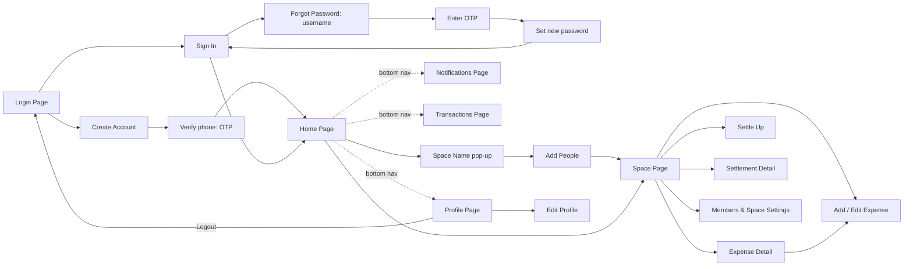
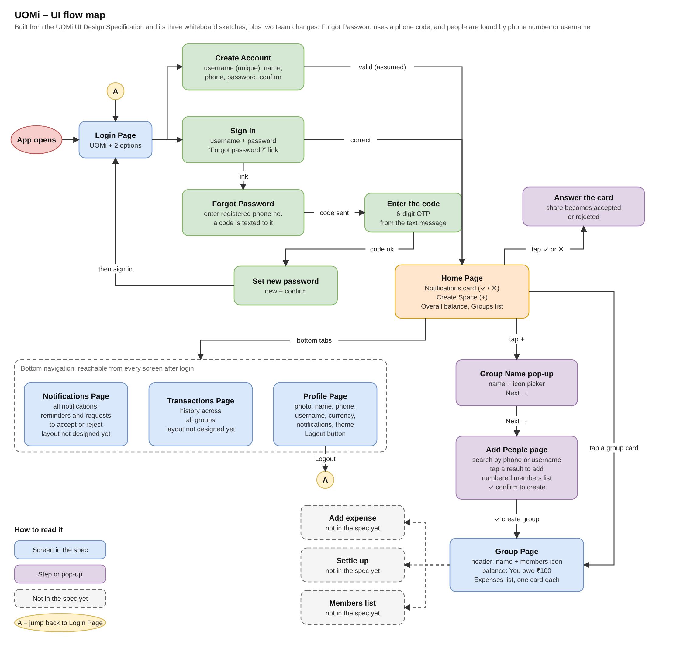
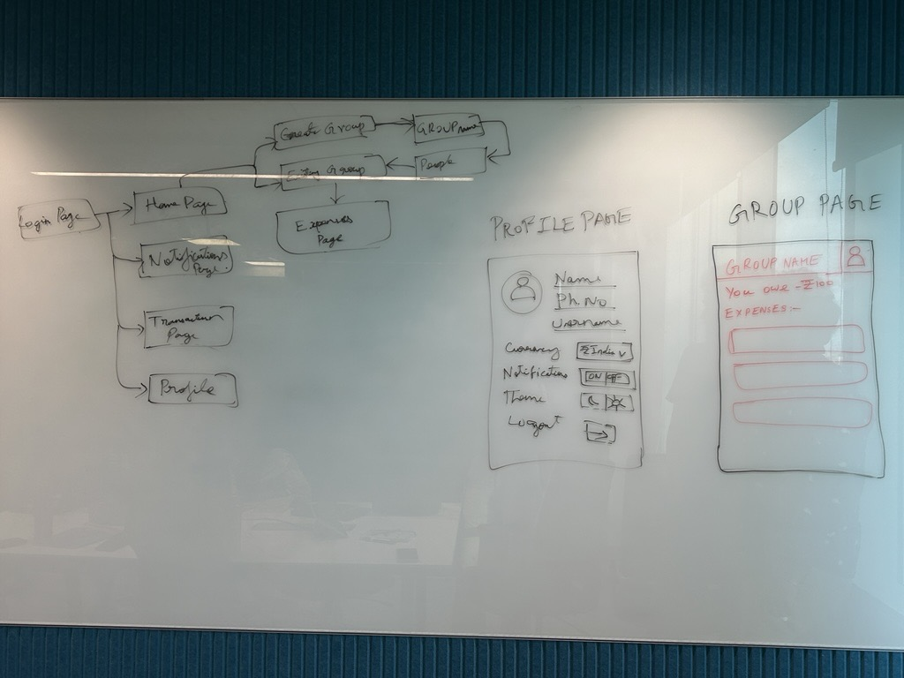
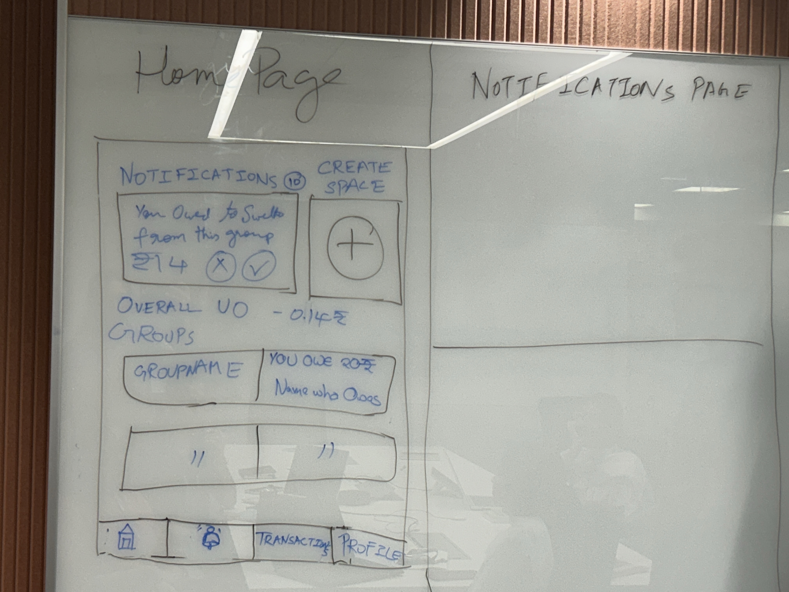
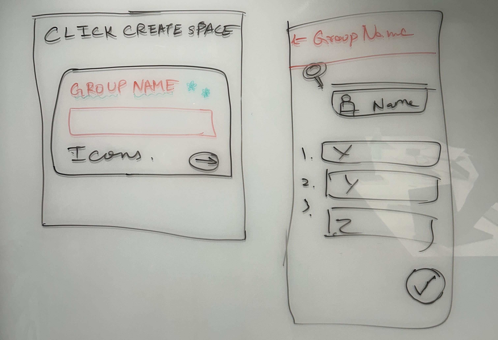

# UOMi – UI Design Specification (Frontend)

**Expense & Transaction Tracking App** · Front-end team · **Draft v3 – 2026-11-06**

> Sources: `UOMi_UI_Specification (Improvised version-claud).pdf` (v1 spec + whiteboard sketches), the team's edits to v1 (OTP on Forgot Password), `image.png` (UI flow map), and the team's answers of 2026-11-06 to the v2 open questions.
>
> **How to read this document**
> - **[Team]** marks a decision the team made on 2026-11-06 (see [§ 16](#16-decisions-and-remaining-items)).
> - **[Call]** marks a decision made while writing this spec. It is a proposal: confirm or overturn it.
> - Anything not marked comes from v1, the sketches, or the team's edits.

---

## 0. Scope

**This phase is planning only.** No app code is written until this spec is approved.

**We are building the frontend only.** No backend exists yet. Everything the UI needs from a server — sign-in, OTP, user search, balances, notifications — is served by a **mock data layer** inside the app (see [§ 14](#14-frontend-data-model-and-mock-layer)). The mock layer shows the contract a future backend has to meet, but building that backend is out of scope.

### Goals

1. Every screen in this spec is navigable end-to-end on an iOS and an Android phone, using mock data.
2. Every screen has defined **loading, empty, error and success** states.
3. The core money loop works in the UI: **create a space → add an expense → accept or reject a share → see balances → settle up → confirm**. Steps done by other people are walked through on one device with the debug "Act as…" switch (§ 14.1).
4. Light and dark themes both work and meet contrast rules.

### Non-goals (this phase)

- Backend, database, real authentication, or real SMS/OTP delivery.
- Real push notifications (the in-app Notifications list is in scope; OS push is not).
- Real payments (UPI, cards, wallets). "Settle up" only **records** that a payment was made outside the app.
- Currency conversion between currencies. **[Call]**
- Receipt photos, attachments, expense comments, recurring expenses. **[Call]**
- Tablet and landscape layouts (portrait phone only, as in v1).
- Inviting people who are not yet UOMi users. **[Call]**
- Final brand palette and logo — being created separately (§ 3.7, § 16.2).

### Anti-goals (would count as failure even if it "works")

- A balance shown on one screen disagrees with the same balance on another screen.
- Money rounding loses or invents a paisa/cent (splits must always add up to the expense total).
- Amounts in different currencies are added together.
- Red/green colour is the only thing telling the user whether they owe or are owed.

---

## 1. Conventions

| Topic | Rule |
|---|---|
| **Space** | **[Team]** The UI calls a group of people a **Space** everywhere: Create Space, Space Name, Space Page, Space Settings. (The data model uses `Space` too.) |
| **Who "you" are** | All balances are shown from the signed-in user's point of view. |
| **Balance wording** | Three states only: **"You owe ₹X"**, **"You are owed ₹X"** (or "X owes you ₹Y" on a single person), **"Settled up"**. **[Call]** |
| **Balance sign** | Negative = you owe; positive = you are owed. v1's "Overall: –₹0.14" therefore means the user owes ₹0.14 overall. |
| **Balance colour** | Owe = red-family token, owed = green-family token, settled = neutral. Always paired with the words above, never colour alone. |
| **Currency** | **[Team]** Each space has **one currency**, set when the space is created (§ 6.1). Every amount in that space uses it. Amounts in different currencies are never added together (§ 5.1). |
| **Money format** | Currency symbol + 2 decimals, formatted per currency. ₹ uses Indian digit grouping (`₹1,23,456.50`); others use 3-digit grouping (`$123,456.50`). Whole amounts may drop `.00` in compact cards (`₹20`). **[Call]** |
| **Rounding** | Amounts are calculated in the currency's smallest unit (paise, cents) as integers. Leftover units are handed out one at a time to people in the split, in member-list order, so the total always matches. **[Call]** |
| **Balance model** | **[Call]** Balances are **pairwise**: for every two people in a space there is one amount, "A owes B ₹X". No "simplify debts" rerouting in this phase. A space is **settled up** for the user only when every one of their pairwise balances in it is 0. What counts toward a balance is defined in § 14.2. |
| **Dates** | Relative in lists ("Today", "Yesterday", "3 Nov"), full date on detail screens. |
| **Phone numbers** | **[Team]** Any country, picked with a country picker (§ 4.2). Shown in international format (`+91 98765 43210`). Masked as `+91 80******31` (first 2 and last 2 digits of the national number) where privacy matters. |

---

## 2. App Flow

| Screen | Where it leads |
|---|---|
| **Login Page** | Entry point. Create Account → Verify phone (OTP) → Home Page. Sign In → Home Page. Forgot password → username → OTP → new password → back to Sign In. |
| **Home Page** | Main dashboard. Leads to Create Space, a Space Page, or a notification's action. |
| **Create Space** | Space Name pop-up → Add People page → the new Space Page. |
| **Space Page** | Add Expense, Expense Detail, Settle Up, Settlement Detail, Members & Space Settings. |
| **Bottom navigation** | From every main screen after login: Home, Notifications, Transactions, Profile. |

### UI flow map

> The flow map was drawn before v2 and is **out of date** in four places. Where it disagrees, this spec wins:
> 1. Forgot Password asks for the **username** (not the phone number) and then shows the masked phone. **[Team]**
> 2. Create Account now goes through **phone verification** before Home. **[Team]**
> 3. The grey "not in the spec yet" boxes (Add expense, Settle up, Members list) are specified in §§ 8–10.
> 4. It says "Group"; the UI says **Space**. **[Team]**

### Screen list

| # | Screen | Status |
|---|---|---|
| 1 | Login Page (Welcome, Create Account, Verify phone, Sign In, Forgot Password + OTP) | v1 + team changes |
| 2 | Home Page (Main Dashboard) | v1, updated for per-space currency |
| 3 | Create Space – Space Name pop-up | v1 + currency picker |
| 4 | Create Space – Add People page | v1, search by phone or username |
| 5 | Space Page | v1, completed in v2 |
| 6 | Add / Edit Expense (4 split types) | New |
| 7 | Expense Detail | New |
| 8 | Settle Up + Settlement Detail | New |
| 9 | Members & Space Settings | New |
| 10 | Notifications Page | Layout new |
| 11 | Transactions Page | Layout new |
| 12 | Profile Page + Edit Profile | v1 + Edit Profile |

---

## 3. Global UI Rules

These apply to every screen.

### 3.1 Layout & navigation

- Portrait phone only; designed at 375 pt wide and must not break at 320 pt or on large phones.
- Respect safe areas (notch, status bar, home indicator) for headers, the bottom nav, and bottom-right action buttons.
- **Bottom navigation** — four tabs, left to right: Home (house), Notifications (bell), Transactions, Profile. **[Call]** Each tab has an icon **and** a text label. The bell tab shows the same unread badge as the Home Page.
- Bottom nav is **shown** on Home, Notifications, Transactions, Profile and Space Page. **[Call]** It is **hidden** on Login screens, the Create Space flow, Add/Edit Expense, Expense Detail, Settle Up, Settlement Detail, Members & Space Settings and Edit Profile, which are focused tasks with a back arrow.
- **Back behaviour:** every non-tab screen has a back arrow (←) at top left; the Android system back does the same thing. Leaving a form with unsaved input asks "Discard changes?". **[Call]**
- Primary actions use a **round icon button at bottom right** (v1 rule): → for Next, ✓ for Confirm/Save, + for Add Expense. The button must sit above the keyboard when a form is being typed in.
- Scrollable content gets bottom padding so the last card is never hidden behind the bottom nav or the round action button.

### 3.2 Screen states (every data screen)

| State | Behaviour |
|---|---|
| **Loading** | Skeleton cards in the same shape as the real content (no blank screen, no layout jump when data arrives). |
| **Empty** | Short message + the action that fixes it, e.g. "No spaces yet — tap + to create one". |
| **Error** | Plain message + **Retry** button. Keep any data already on screen. |
| **Offline** | Banner "You're offline — showing last saved data". Actions that change data are disabled with a reason. **[Call]** |

### 3.3 Forms

- Every field has a visible label (not placeholder-only) and a helper or error line **below** it.
- Validate on blur, and again on submit. On a failed submit, scroll to and focus the first invalid field.
- The submit button is disabled while a request is in flight and shows a spinner; double taps do nothing.
- Allow paste and password-manager autofill on all username, password and OTP fields.
- Password fields have a show/hide (eye) toggle.
- Numeric fields open the matching keyboard (decimal pad for amounts, number pad for OTP and shares, phone pad for phone).

### 3.4 OTP entry (shared component)

Used by **Verify phone** (§ 4.3) and **Forgot Password** (§ 4.5). **[Call]**

- Text: "We sent a 6-digit code to +91 80******31".
- Six-box input; paste and SMS autofill allowed (iOS one-time-code suggestion, Android SMS autofill).
- **Resend code** link, disabled for 30 s with a countdown.
- Wrong code → "That code is incorrect", boxes cleared, focus back on the first box. After 5 wrong attempts → "Too many attempts — try again in 10 minutes".
- Code valid for 5 minutes; expired → "Code expired — resend".
- Mock OTP is always `123456`.

### 3.5 Feedback

- Every tap gives visible pressed feedback.
- Successful actions confirm with a short toast ("Expense added", "Payment recorded").
- Destructive actions (delete expense, remove member, leave/delete space, cancel payment, logout) need a confirm dialog that names what will happen.

### 3.6 Accessibility

- Text contrast ≥ 4.5:1 in **both** themes; icons and control borders ≥ 3:1.
- Touch targets ≥ 44×44 pt (48×48 dp on Android), including ✕/✓ buttons on notification cards.
- Icon-only buttons (✕, ✓, →, +, ←, bell, members icon) have spoken labels, e.g. "Accept your ₹14 share of Dinner".
- Badge counts are announced with context ("10 unread notifications"), not as a bare number.
- Supports the largest system text size without clipping; respects "reduce motion".

### 3.7 Visual style

- Rounded cards throughout for notifications, spaces, members, expenses and transactions (v1).
- Vector icons from **one** icon family, one style (outline or filled) per level; no emoji as icons. **[Call]**
- Colours, type sizes, spacing (4/8 pt rhythm) and corner radii come from **design tokens** with light and dark values. No colour is hard-coded on a screen.
- **Brand template and logo are not created yet. [Team]** Until they exist, the app uses a neutral placeholder palette and a text wordmark "UOMi" set in Fraunces. **[Call]** Because every colour goes through tokens, swapping in the brand palette later changes one file, not the screens.
- Theme defaults to the **phone's system setting** until the user picks one in Profile. **[Call]**

### 3.8 Typography

**[Team]** The app uses **Fraunces** (`assets/fonts/fraunces/Fraunces-Variable.ttf`, SIL Open Font License, `OFL.txt` alongside it).

Checked in the font file itself:

| Fact | Consequence |
|---|---|
| The file's **default instance is Black (weight 900) with the "wonky" letterforms on** (axes: `opsz` 9–144, `wght` 100–900, `SOFT` 0–100, `WONK` 0–1). | React Native can't reliably set variable-font axes on both platforms; loaded as-is, every piece of text would render Black and wonky. **[Call]** Ship **five static instances** generated from the variable file at build time, all with `WONK=0` and `SOFT=0`: **Text** (opsz 14) at Regular 400, SemiBold 600 and Bold 700; **Display** (opsz 72) at SemiBold 600 and Bold 700. Text Bold exists for the small bold marks (stamp, member plates, wordmark); Display cuts are thin-stroked at small sizes, so they're reserved for 28px and up. |
| The font has **no tabular figures** (`tnum`) — only `case`, `liga`, `ss01`. | Digits have different widths, so amounts don't line up in columns. **[Call]** Right-align amounts in lists and never rely on digit columns aligning; no animated "ticking" numbers. |
| The font has **no small caps** (`smcp`). | Serials and stamps use uppercase with tracking instead; tracking is applied **only** to all-caps text, never to mixed case. |

**Type scale** — taken from the approved HTML prototype (`DESIGN.md` § Typography is the source of truth; this table mirrors it). Only weights 400 / 600 / 700 are used.

| Role | Size / line height | Weight | Static instance | Used for |
|---|---|---|---|---|
| Display | 32 / 38, −0.02em | 600 | Display SemiBold | Large screen titles (Notifications, Transactions, Profile) |
| Hero figure | 40 / 48, −0.02em | 600 | Display SemiBold | Amount on Expense / Payment detail; the amount entry field |
| Figure | 28 / 34 | 600 | Display SemiBold | Running-total lines, space balance, currency symbol in the amount field |
| Title | 20 / 26 | 600 | Text SemiBold | App-bar titles, section headings, dialog and sheet headings |
| Wordmark | 22 / 28, −0.015em | 700 | Text Bold | "UOMi" placeholder wordmark on Home (56 / 60 Display Bold on Welcome) |
| Body | 16 / 22 | 400 | Text Regular | Running text, row names, inputs, bill titles, toasts |
| Label | 13 / 18 | 600 | Text SemiBold | Sub-lines, helper text, field labels, tabs, chips, segments, badge |
| Serial | 13 / 18, +0.08em, uppercase | 600 | Text SemiBold | "NO. 0412" serials, month dividers |
| Stamp | 12 / 14, +0.12em, uppercase | 700 | Text Bold | Stamp lettering; 12px is also the floor for status tags |

One-offs that stay on the scale's instances: OTP digits 26 (Display SemiBold); member-plate initials 14 / 28 (Text Bold). All sizes scale with the system text size (cap tab labels and OTP digits at about 1.5× so they don't break).

> Fraunces is a serif built for display use. Readability of 12–14 pt amounts in long lists must be checked on a real low-end Android phone early in the build. If it fails, the fix is a heavier Text weight or larger minimum size, not a second typeface (the team chose one font).

---

## 4. Login Page

### 4.1 Welcome

The first screen the user sees. It shows the app name **UOMi** at the top and two options: **Create Account** and **Sign In**.

If the user is already signed in on this device, the app skips this screen and opens the Home Page. **[Call]**

### 4.2 Create Account

| Field | Details |
|---|---|
| **Username** | Must be unique. The username is required to reset the password, so it acts as the account's recovery key. **[Call]** Rules: 3–20 characters, lowercase letters, digits, `_` and `.`; shown "✓ available" / "✗ taken" after the user stops typing. |
| **Name** | The user's full name. Required, 1–50 characters. |
| **Phone number** | Used by other people to find and add this user to spaces. During forgot password OTP should be triggered to the phone number. **[Team]** A **country picker** (flag + dial code, searchable, default from the phone's region, falling back to India +91) next to the number field; the number is validated for the chosen country; must be unique. |
| **Password** | Password field. **[Call]** At least 8 characters with at least one letter and one number; strength hint shown below. |
| **Confirm password** | Must match the password above. |

- **Create Account** button at the bottom; disabled until every field passes validation.
- Errors: "Username already taken", "Phone number already registered", "Passwords don't match" — each shown under its own field.
- On success → **Verify phone** (§ 4.3).
- Link at the bottom: "Already have an account? Sign in".

### 4.3 Verify phone *(new in v3)*

**[Team]** The phone number must be verified before the account exists.

- Uses the shared OTP component (§ 3.4) with the full number masked.
- "Wrong number? Edit" link returns to Create Account with every field kept.
- Correct code → account created → Home Page (empty state, § 5.3).
- **[Call]** If the user leaves before verifying, no account is created; the username and phone stay free.

### 4.4 Sign In

| Field | Details |
|---|---|
| **Username** | Registered username. |
| **Password** | Account password. |
| **Forgot password?** | Link that opens the Forgot Password sub-page. |

- **Sign In** button; on success → Home Page.
- On failure: one message "Username or password is incorrect" (never say which one was wrong). **[Call]**
- Link at the bottom: "New here? Create an account".

### 4.5 Forgot Password (sub-page)

1. The user enters their registered username.
2. If the username is correct, OTP should be triggered to the registered phone number by showing like 80******31 and user enter the otp so that the user can set a new password (new password + confirm).

**[Team]** Confirmed: username first, then the masked phone and OTP. Details:

| Step | Screen content |
|---|---|
| **a. Username** | Username field + **Send code** button. Unknown username → "We couldn't find that username". |
| **b. Enter OTP** | Shared OTP component (§ 3.4), showing the masked registered phone, e.g. "+91 80******31". |
| **c. New password** | New password + Confirm password (same rules as § 4.2). **Save** → toast "Password updated" → back to **Sign In**, with the username filled in. |

---

## 5. Home Page (Main Dashboard)

The main screen after login. Sections are listed from top to bottom.

### 5.1 Elements

| Element | Details |
|---|---|
| **Notifications** | Heading with a small round badge showing the number of unread notifications (e.g. 10). Below it, a card shows the **latest notification that needs an answer**, for example *"You owe ₹14 to Swetha from this space"*, with two buttons: ✕ (reject) and ✓ (accept). What ✕/✓ do depends on the type (§ 11.2). Tapping the card body or the heading opens the Notifications Page. |
| **Create Space** | Sits to the right of the Notifications card. A square card with a large "+" button, labelled "Create Space". Tapping it opens the Space Name pop-up (§ 6.1). |
| **Overall balance banner** | A small banner that adds up the user's balance across all spaces into one figure (e.g. "Overall: –₹0.14"). **[Call]** Shown as words + amount: "Overall, you owe ₹0.14" / "Overall, you are owed ₹250" / "You're all settled up". Because each space has its own currency, totals are **per currency**, one line each: "You owe ₹120 · You are owed $15". |
| **Spaces** | A list of the user's spaces. Each space is a wide card split in two: **space icon + space name on the left**, and on the **right** the balance summary in that space's currency. **[Call]** One person → "You owe ₹20 · Swetha"; several → "You owe ₹20 · 2 people"; all pairwise balances 0 → "Settled up"; net 0 but some pairwise balances open → "₹0 net · 2 open balances". Sorted by most recent activity. Tapping a card opens the Space Page. |
| **Bottom navigation bar** | Four tabs, left to right: Home (house icon), Notifications (bell icon), Transactions, Profile. Shown on all main screens (§ 3.1). |

### 5.2 Notification card rules

- If nothing needs an answer, the card shows the latest notification without buttons. If there are no notifications at all: "You're all caught up". **[Call]**
- After ✓/✕, the card animates out, the next one slides in, and the badge count drops by one.

### 5.3 States

- **Empty (new user):** Notifications card shows "You're all caught up"; banner shows "You're all settled up"; Spaces area shows "No spaces yet — tap + to create your first space".
- **Loading / Error / Offline:** as in § 3.2.

---

## 6. Create Space

Creating a space happens in two steps.

### 6.1 Step 1 – Space Name pop-up

Tapping "+" on the Home Page opens a pop-up card over the screen (dimmed background).

| Element | Details |
|---|---|
| **Space Name** | Label (marked required `*`, as in Sketch C) and a text input box for the name of the space. **[Call]** 1–30 characters; leading/trailing spaces trimmed. |
| **Icons** | A row of icons below the input. The user picks one as the space's icon. **[Call]** 8 preset icons (e.g. home, trip, food, office, friends, car, party, other); the first is pre-selected so the step never blocks. |
| **Currency** | **[Team]** Dropdown for the space's currency. **[Call]** Defaults to the user's default currency (Profile, § 13). |
| **Next button** | Round button with a right arrow (→) at the bottom right of the card. Disabled until the name is valid. Takes the user to the Add People page. |
| **Close** | **[Call]** Tapping outside the card or a ✕ at the top right closes the pop-up without creating anything. |

### 6.2 Step 2 – Add People page

A full page for adding members to the new space.

| Element | Details |
|---|---|
| **Header** | Back arrow (←) on the left, followed by the space name entered in Step 1. Back returns to the pop-up with the name, icon and currency kept. |
| **Search bar** | **[Team]** Search icon with one input that finds users by **phone number or username**. **[Call]** A query of digits (optionally with `+`) is treated as a phone number in the user's own country unless a dial code is typed, and must match a **whole** number. Anything else matches usernames by prefix. Partial phone numbers never match, so nobody can browse other people's numbers. Results update 300 ms after typing stops. |
| **Search result** | Each matching user appears as a card with a profile icon, their name and username. Tapping it adds them to the space. People already added show "Added" and can't be added twice. |
| **No result** | "No UOMi user found for '…'". (Inviting non-users is out of scope.) |
| **Members list** | A numbered list of everyone added so far (1. X, 2. Y, 3. Z …), each in its own row. **[Call]** Row 1 is always **"You"** and can't be removed; every other row has a remove (✕) button. |
| **Confirm button** | Round ✓ button at the bottom right. Creates the space with the selected members → opens the new Space Page → toast "Space created". **[Call]** Enabled once at least one other person is added. The creator becomes the space's **owner** (§ 10.1). |

---

## 7. Space Page

Opens when the user taps a space on the Home Page (or right after creating one).

| Element | Details |
|---|---|
| **Header** | Back arrow, space icon + space name on the left, members icon on the right → opens Members & Space Settings (§ 10). |
| **Balance** | What the user owes in this space, e.g. "You owe: ₹100" (wording per § 1). **[Call]** Below it, a per-person breakdown: "You owe Swetha ₹60", "Arun owes you ₹40", collapsed to the first 3 with "See all". |
| **Settle up button** | **[Call]** Secondary button under the balance. Opens Settle Up (§ 9). Shown only when the user owes at least one member (pairwise). |
| **Expenses** | An "Expenses" heading followed by a list of all expenses in the space, one card per expense, newest first, grouped by month. **[Call]** Card: description, date, "Paid by Swetha · ₹300", and the user's part on the right ("you owe ₹100" / "you lent ₹200" / "not involved"). Tags: **Disputed** (someone rejected their share), **Needs your answer** (your share is pending). Recorded settlements appear in the same list with a different icon: "Arun paid Swetha ₹50" (+ "Pending" tag until confirmed). Tapping an expense opens Expense Detail (§ 8.3); tapping a settlement opens Settlement Detail (§ 9.1). |
| **Add expense button** | **[Call]** Round **+** button at the bottom right (v1 primary-action rule). Opens Add Expense (§ 8.1). |

**Empty state:** "No expenses yet — tap + to add the first one."

---

## 8. Expenses

### 8.1 Add / Edit Expense

Full screen; header "← Add expense" (or "← Edit expense"). Bottom nav hidden. Any member can add an expense; only its creator can edit it (§ 10.1).

| Field | Details |
|---|---|
| **Description** | Required, 1–50 characters, e.g. "Dinner". |
| **Amount** | Required, > 0, max 2 decimals, decimal keypad, prefixed with the space's currency symbol. **[Call]** Upper limit 99,99,999.99 / 9,999,999.99 per expense. |
| **Paid by** | One member, defaults to "You". **[Call]** Single payer only in this phase. |
| **Split between** | Checklist of space members, all ticked by default. At least one must stay ticked. |
| **Split type** | **[Team]** Four options as a segmented control: **Equally · Exact · Percent · Shares** (§ 8.2). |
| **Date** | Defaults to today; date picker; future dates not allowed. |
| **Save** | Round ✓ at bottom right, disabled until the split is valid → back to Space Page → toast "Expense added". |

**[Call]** Saving an edit resets every share's answer to *pending* and re-notifies everyone in the split (§ 11.2).

### 8.2 Split types

**[Team]** All four are needed. **[Call]** for the details below.

| Type | What the user enters per ticked person | Valid when | Live helper line |
|---|---|---|---|
| **Equally** | Nothing | Always | "₹100.00 each" |
| **Exact** | An amount | Amounts add up to the total | "₹40.00 left to assign" / "₹10.00 over" |
| **Percent** | A percentage (up to 2 decimals) | Percentages add up to 100% | "20% left" / "5% over" |
| **Shares** | A whole number ≥ 1 (default 1), e.g. 2 : 1 : 1 | At least one share | Each row shows its resulting amount, e.g. "2 shares · ₹150.00" |

- Every row shows the amount that person will owe, updated live as the user types.
- Percent and Shares convert to amounts using the rounding rule in § 1.
- Switching split type keeps the ticked people and clears the per-person values.
- Unticking a person removes their value; ticking one adds a row with an empty value (Shares: 1).

### 8.3 Expense Detail

| Element | Details |
|---|---|
| **Header** | ← back. **Edit** (pencil) and **Delete** (bin) icons on the right, **visible only to the expense's creator**. **[Team]** |
| **Summary** | Description, amount, date, "Added by X on <date>", split type. |
| **Paid by** | Payer and amount. |
| **Split** | One row per person: name, their share, and their answer (Accepted / Pending / Rejected). The user's own row is highlighted. |
| **Your answer** | **[Call]** If the user's share is pending: **Reject** and **Accept** buttons here as well as on the notification. |
| **Delete** | Creator only. Confirm dialog "Delete 'Dinner'? Balances will be recalculated." → back to Space Page → toast. |

---

## 9. Settle Up

Records a payment the user made **outside** the app (cash, UPI, etc.). No real money moves.

| Element | Details |
|---|---|
| **Header** | "← Settle up". |
| **Pay to** | List of the people the user owes in this space, each with the amount owed. Tapping one selects them. If the user owes only one person, that person is pre-selected. |
| **Amount** | Pre-filled with the full amount owed **minus any pending payments to that person** (so the same debt can't be recorded twice); can be lowered for a partial payment; can't exceed that figure. **[Call]** |
| **Confirm** | Round ✓ → "Payment recorded" toast → the payment appears in the Space Page list as **Pending** until the other person confirms it (§ 11.2). |

**[Call]** In this phase only the person who owes can record a payment ("I paid Swetha"). "Swetha paid me" (recorded by the receiver) is not in scope.

### 9.1 Settlement Detail

**[Call]** Opened by tapping a payment in the Space Page or Transactions list.

| Element | Details |
|---|---|
| **Header** | "← Payment". |
| **Summary** | "Arun paid Swetha ₹50", space name, date recorded, status: **Pending**, **Confirmed** or **Rejected** (with the date it was answered). |
| **Answer** | If the user is the receiver and it's pending: **Reject** and **Confirm** buttons. |
| **Cancel payment** | Only for the person who recorded it, only while **Pending**. Confirm dialog → the payment is removed and the receiver's notification disappears. Confirmed payments can't be cancelled. |

---

## 10. Members & Space Settings

Opened from the members icon on the Space Page header.

| Element | Details |
|---|---|
| **Space info** | Space icon + name, with **Edit** (same rules as § 6.1). |
| **Currency** | The space's currency. **[Call]** Only the owner can change it, and only while the space has no expenses; otherwise it is shown read-only with "Can't change after expenses are added". |
| **Members** | List: profile icon, name, username, their balance with the user, and an "Owner" tag on the creator. "Add people" row at the top → reuses the Add People search (§ 6.2). |
| **Remove member** | Owner only. ⋯ menu on a member row → confirm. Only allowed when **all** of that member's pairwise balances in the space are 0; otherwise disabled with "Settle up first". |
| **Leave space** | **[Team]** Any member **except the owner**. **[Call]** Only when all of the user's pairwise balances in the space are 0; confirm dialog. |
| **Delete space** | **[Team]** **Owner only.** **[Call]** Only when everyone in the space is settled up; confirm dialog naming the space. Members get a "Space deleted" notification. |

### 10.1 Who can do what

| Action | Who | Source |
|---|---|---|
| Add an expense | Any member | [Call] |
| Edit an expense | Its creator only | [Call] (follows the delete rule) |
| Delete an expense | Its creator only | [Team] |
| Accept / reject a share | The person whose share it is | [Team] |
| Record a payment | The person who owes | [Call] |
| Confirm / reject a payment | The person receiving it | [Call] |
| Cancel a pending payment | The person who recorded it | [Call] |
| Add people to the space | Any member | [Call] |
| Rename the space / change its icon | Any member | [Call] |
| Change the space's currency | Owner, only before the first expense | [Call] |
| Remove a member | Owner only, when that member is settled up | [Call] |
| Leave the space | Any member except the owner, when settled up | [Team] + [Call] |
| Delete the space | Owner only, when everyone is settled up | [Team] + [Call] |

> **[Call]** The owner can't leave and ownership can't be handed over in this phase. An owner who wants out has to settle everyone up and delete the space.

---

## 11. Notifications Page

Opened from the bell icon. Shows the full list of notifications, such as payment reminders and requests to accept or reject a settlement.

### 11.1 Layout

- Header "Notifications" + "Mark all as read" text button.
- Two sections: **Needs your answer** (cards with ✕/✓) on top, then **Earlier**, grouped by Today / Yesterday / date.
- Each card: icon for its type, message, space name, relative time; unread cards have a dot and stronger text.
- Tapping a card marks it read and opens the related screen: the expense, the payment, or the space. Exception: a **Reminder** opens Settle Up for that space.
- Empty state: "No notifications yet".

### 11.2 Notification types

**[Team]** Both expense shares **and** payments are answered with ✕/✓. A rejected share is reported to the person who created the expense.

| Type | Sent to | Example message | Actions |
|---|---|---|---|
| **Expense share** | Everyone in the split except the creator | "Swetha added 'Dinner' — your share is ₹14" | ✓ Accept · ✕ Reject |
| **Share rejected** | The expense's **creator** **[Team]** | "Arun rejected his ₹14 share of 'Dinner' in Flatmates" | none — tapping opens Expense Detail so the creator can edit or delete it |
| **Payment to confirm** | The person receiving the payment | "Arun says he paid you ₹50" | ✓ Confirm · ✕ Reject |
| **Payment answered** | The person who recorded the payment | "Swetha confirmed your ₹50 payment" / "Swetha rejected your ₹50 payment" | none |
| **Added to space** | The person added | "Swetha added you to 'Goa Trip'" | none |
| **Space deleted** | All members | "Swetha deleted 'Goa Trip'" | none |
| **Reminder** | A person who owes | "You owe Swetha ₹14 in 'Flatmates'" | none (tapping opens Settle Up) |

- **[Call]** Accepting a share sends no notification (it would only add noise).
- **[Call]** A rejected expense becomes **Disputed**: it stays visible with the tag but stops counting toward balances until its creator edits it (which resets everyone's answers) or deletes it.
- **[Call]** Reminders are created by the mock layer from seed data only; there is no "send reminder" button in this phase.

---

## 12. Transactions Page

Opened from the Transactions tab. Shows the user's transaction history across all spaces.

- Header "Transactions".
- Filter chips: **All · Expenses · Payments**, plus a **Space** dropdown (all spaces by default).
- List grouped by month, newest first. Each row: icon (expense/payment), description, space name, date, and the user's effect on the right in that space's currency ("you owe ₹100", "you lent $20", "you paid ₹50", "you received ₹50"). Tags: Pending, Disputed.
- Tapping a row opens Expense Detail or Settlement Detail.
- Empty state: "No transactions yet". Filtered empty: "Nothing matches these filters" + "Clear filters".
- **[Call]** No totals on this page (rows may be in different currencies), no search, no export, no date-range filter in this phase.

---

## 13. Profile Page

Opened from the Profile tab, the right-most icon in the bottom navigation bar.

| Section | Details |
|---|---|
| **Profile details** | Round profile photo on the left. Beside it: Name, Phone number, Username. **[Call]** An **Edit** link opens Edit Profile. Without a photo, initials are shown on a coloured circle. |
| **Default currency** | Dropdown to choose the currency, e.g. ₹ India. **[Team]** Currency now belongs to each space, so this is only the **default for new spaces**. **[Call]** Initially set from the phone-number country (₹ for +91). |
| **Notifications** | On / Off toggle. **[Call]** Controls (future) push alerts only; the in-app Notifications list always works. In this phase it's a stored preference with no visible effect beyond its own state. |
| **Theme** | Toggle between dark (moon icon) and light (sun icon). **[Call]** Until the user touches it, the app follows the phone's system theme. |
| **Logout** | Button with a logout icon that signs the user out. **[Call]** Confirm dialog "Log out of UOMi?" → Welcome screen. |

### 13.1 Edit Profile

- Change photo (camera / gallery / remove), Name.
- **[Call]** Username and phone number are **read-only** in this phase. The username is the recovery key; changing the phone would need its own OTP flow.
- **[Call]** Change password is not in this phase; users can use Forgot Password.

---

## 14. Frontend Data Model and Mock Layer

The UI reads and writes through **one service module** with an interface per area. In this phase every interface is served by mock data with a short fake delay (300–800 ms) and a switch to simulate errors, so every loading and error state can be seen. **[Call]** Swapping in a real backend later should only replace the mock implementation, not the screens.

### 14.1 Mock behaviour **[Call]**

- **Persistence:** mock data is saved to device storage, so it survives an app restart (this is also the "last saved data" the Offline banner shows). The session token is kept in secure storage. A **Reset demo data** action restores the seed.
- **Playing the other users:** with no backend, nobody else can answer a share or confirm a payment. A hidden **debug menu** (long-press the UOMi wordmark on the Profile page) offers **"Act as…"** to switch the signed-in user to any seeded user. That way the full loop — A adds an expense → B accepts or rejects → B pays → A confirms — can be walked through on one device. The debug menu also holds the error switch and Reset demo data, and is left out of production builds.

### 14.2 Balance rules **[Call]**

Balances are **not stored**. One shared calculator works them out per space, and every screen reads from it, so the same number appears everywhere (anti-goal 1).

| Item | Counts toward balances? |
|---|---|
| Expense whose shares are all *pending* or *accepted* | **Yes**: unanswered shares count, so the app is useful before everyone responds. |
| Expense that is *disputed* (any share *rejected*) | **No**, until its creator edits it (answers reset) or deletes it. |
| Payment *confirmed* | **Yes**. |
| Payment *pending* | **No** for balances; **yes** for the Settle Up maximum (§ 9). |
| Payment *rejected* or *cancelled* | **No**. |

### 14.3 Entities (frontend types)

| Entity | Fields |
|---|---|
| **User** | `id`, `username`, `name`, `phone` (E.164, e.g. `+919876543210`), `phoneVerified`, `avatarUrl?` |
| **Space** | `id`, `name`, `icon`, `currency` (ISO code, e.g. `INR`), `ownerId`, `memberIds[]`, `createdAt` |
| **Expense** | `id`, `spaceId`, `description`, `amountMinor` (integer, smallest unit), `paidBy`, `splitType` (`equal` \| `exact` \| `percent` \| `shares`), `shares[] {userId, input, amountMinor, response}`, `date`, `createdBy`, `updatedAt`. `input` holds what was typed: nothing for equal, an amount for exact, a percentage for percent, a whole number for shares. `response` is `pending` \| `accepted` \| `rejected`; the payer's own share is `accepted` automatically. Status is **derived**: `disputed` if any share is `rejected`, otherwise `active`. |
| **Settlement** | `id`, `spaceId`, `fromUserId`, `toUserId`, `amountMinor`, `date`, `status` (`pending` \| `confirmed` \| `rejected` \| `cancelled`), `answeredAt?` |
| **Notification** | `id`, `userId`, `type`, `message`, `spaceId?`, `refId?`, `needsAnswer`, `read`, `createdAt` |
| **Preferences** | `defaultCurrency`, `theme` (`system` \| `light` \| `dark`), `notificationsOn` |

### 14.4 Mock services

| Service | Operations the UI needs |
|---|---|
| **Auth** | `signUp` (returns a pending sign-up), `verifySignUpOtp`, `signIn`, `signOut`, `checkUsername`, `checkPhone`, `requestResetOtp(username)` → masked phone, `verifyResetOtp`, `resetPassword`, `resendOtp` |
| **Users** | `search(query)` (whole phone number or username prefix) |
| **Spaces** | `list`, `get`, `create`, `update` (name, icon, currency), `addMembers`, `removeMember`, `leave`, `delete` |
| **Expenses** | `list(spaceId)`, `get`, `create`, `update`, `delete`, `acceptShare`, `rejectShare` |
| **Settlements** | `get`, `create`, `confirm`, `reject`, `cancel` |
| **Balances** | `forSpace(spaceId)`, `overall()` (grouped by currency) |
| **Notifications** | `list`, `markRead`, `markAllRead`, `unreadCount` |
| **Transactions** | `list(filter)` |
| **Profile** | `get`, `update`, `getPreferences`, `setPreferences` |
| **Debug** | `actAs(userId)`, `resetDemoData`, `setSimulateErrors(on)` |

### 14.5 Seed data

The signed-in user + 5 other users (at least one with a non-Indian phone number); 4 spaces: one where the user owes, one where they are owed, one settled, one with 0 net but open pairwise balances, and **one space in a currency other than ₹**. About 12 expenses covering all four split types, one disputed; one pending payment; notifications of every type, at least two needing an answer. Mock OTP is `123456`.

---

## 15. Tech Stack

**[Team]** "Any tech stack which is lightweight and can support all our features." **[Call]** for the choice below.

**Choice: React Native with Expo (managed workflow), TypeScript, iOS + Android.**

Why this fits:

- One codebase for both phones; development runs in Expo Go or a dev build, with no native project to maintain.
- Covers every feature in this spec: SMS/one-time-code autofill, Android back button, camera/gallery for the profile photo, safe areas, secure storage, custom fonts, and system light/dark mode.
- Ruled out: a **mobile web app (PWA)** is lighter, but iOS limits web-app push notifications to apps added to the home screen, and the bottom-nav/back/keyboard behaviour is harder to make feel native. **Flutter** works too, but produces a larger app and the team would have to learn Dart.

| Concern | Choice **[Call]** |
|---|---|
| Navigation | Expo Router (file-based): auth stack, bottom tabs, and stacks for the space screens |
| Data from the mock layer | TanStack Query on top of the mock services (gives loading/error/refetch states for free; becomes the real API client later) |
| Small app state (theme, debug "act as") | Zustand |
| Forms & validation | React Hook Form + Zod (Zod schemas double as the entity types in § 14.3) |
| Mock data persistence | AsyncStorage |
| Session token | expo-secure-store |
| Phone numbers & country picker | libphonenumber-js + a bundled country list |
| Money formatting | `Intl.NumberFormat` per currency, integer minor units for all maths |
| Fonts | expo-font with the static Fraunces instances (§ 3.8) |
| Profile photo | expo-image-picker |
| Styling | `StyleSheet` + a theme-token module (no extra styling library, to stay light) |
| Lists | FlatList |
| Tests | Jest + React Native Testing Library; the balance calculator and split maths get full unit tests |

---

## 16. Decisions and Remaining Items

### 16.1 Team decisions (2026-11-06)

| # | Question | Decision |
|---|---|---|
| 1 | What do ✕/✓ on a notification do? | Both: accept/reject your **share of an expense**, and confirm/reject a **payment**. A rejected share is reported to the expense's creator. |
| 2 | Tech stack | Anything lightweight that supports all features → React Native + Expo (§ 15). |
| 3 | Forgot Password | Username → masked phone → OTP → new password. |
| 4 | Currency | Per space. |
| 5 | Font & brand | Fraunces; brand template and logo still to be created. |
| 6 | Split types | All four: Equally, Exact, Percent, Shares. |
| 7 | Permissions | Only the space creator deletes the space; other members can leave but not delete. Only an expense's creator can delete it. |
| 8 | Add People search | Phone number or username. |
| 9 | Phone numbers | Any country, with a country picker. |
| 10 | Verify phone at sign-up | Yes, by OTP. |
| 11 | Group or Space | **Space**. |

### 16.2 Still open

- **Brand palette and logo** — in progress separately. Screens use placeholder tokens and a text wordmark until then (§ 3.7).

### 16.3 Calls most worth checking

These change screens, not just text, if overturned:

1. **Edit an expense = creator only**, same as delete (§ 10.1).
2. **Owner can't leave the space** and ownership can't be transferred (§ 10.1).
3. **Only the owner removes members**; any member can add people and rename the space (§ 10.1).
4. **Single payer per expense** (§ 8.1).
5. **Only the person who owes records a payment** (§ 9).
6. **Pairwise balances, no "simplify debts"** (§ 1).
7. **Unanswered shares count toward balances; disputed expenses don't** (§ 14.2).
8. **Space currency is locked after the first expense** (§ 10).
9. **Static Fraunces instances** instead of the variable file (§ 3.8).

---

## Design Notes

- The app is designed for mobile (portrait) screens.
- Each space has one currency, chosen when it is created; ₹ is the default for Indian numbers. Amounts are never converted.
- Rounded cards are used throughout for notifications, spaces, members, expenses and transactions.
- Primary actions (Next, Confirm, Add expense) use round icon buttons placed at the bottom right.
- Both light and dark themes need to be supported.
- Typeface: Fraunces, as static instances.

## Change Log

| Version | Date | Changes |
|---|---|---|
| v1 | — | PDF spec: 8 screens + 3 whiteboard sketches. |
| v1.1 | 2026-11-06 | Team edit: Forgot Password sends an OTP to the masked registered phone. |
| v2 | 2026-11-06 | Embedded sketches and flow map. Added scope (frontend-only, mock data), conventions, global UI rules, screen states, validation rules, Add/Edit Expense, Expense Detail, Settle Up, Settlement Detail, Members & Settings, Notifications and Transactions layouts, Edit Profile, frontend data model, balance rules, mock persistence and "Act as…" debug switch, open questions. Revised after an independent builder review. |
| v3 | 2026-11-06 | Applied the team's 11 answers: Space naming; per-space currency and per-currency overall totals; phone verification at sign-up; country picker; search by phone or username; four split types; permissions table; "Share rejected" notification to the creator; Fraunces typography (static instances, no tabular figures); tech stack (React Native + Expo). |
| v3.1 | 2026-11-06 | § 3.8 aligned with the approved HTML prototype and `DESIGN.md`: type scale replaced with the built roles (Display 32, Hero figure 40, Figure 28, Title 20, Wordmark 22, Body 16, Label 13, Serial 13, Stamp 12); weights limited to 400/600/700; a fifth static instance (Text Bold 700) added for the stamp, plates and wordmark; no-small-caps rule recorded. |

---

## Appendix – Reference Sketches

The three whiteboard photos from the PDF, extracted at full resolution into `assets/sketches/`. The sketches say "Group" and "Create Space"; the UI now says **Space** throughout.

### Sketch A – App flow, Profile Page and Group Page

- **Flow diagram:** Login Page → Home Page, Notifications Page, Transactions Page, Profile. Home Page → Create Group → Group Name → People → back; Home Page → Existing Group → Expenses Page.
- **Profile Page:** profile icon with Name, Ph No, Username beside it; rows for Currency (₹ India dropdown), Notifications (On/Off), Theme (moon/sun), Logout (icon button).
- **Group Page:** header with group name and a person icon on the right; "You owe – ₹100"; "Expenses –" followed by stacked rounded expense cards.

### Sketch B – Home Page (Main Dashboard)

- "Notifications" heading with a badge showing 10; a card reading "You owe ₹14 to Swetha from this group" with ✕ and ✓ buttons.
- "Create Space" square card with a large "+" to the right of the notification card.
- "Overall UO – 0.14₹" banner.
- "Groups" list: two-column cards, "GROUPNAME" on the left and "YOU OWE 20₹ / Name who owes" on the right; a second card repeats the pattern.
- Bottom bar: home icon, bell icon, Transactions, Profile.
- A blank "Notifications Page" frame is drawn next to the Home Page (not yet designed).

### Sketch C – Create Space: Group Name pop-up and Add People page

- **Left ("Click Create Space"):** pop-up card with "GROUP NAME" label (marked with an asterisk), a text input, "Icons" below it, and a round → button at the bottom right.
- **Right:** header "← Group Name"; a search (magnifier) icon with an input; a result card with a person icon and "Name"; a numbered list 1. X, 2. Y, 3. Z; a round ✓ button at the bottom right.
